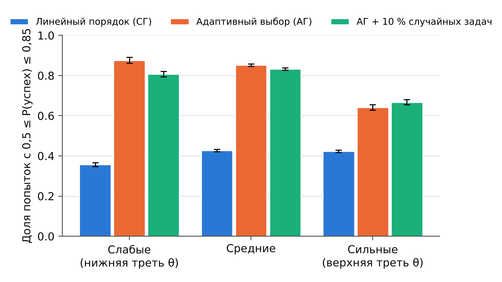
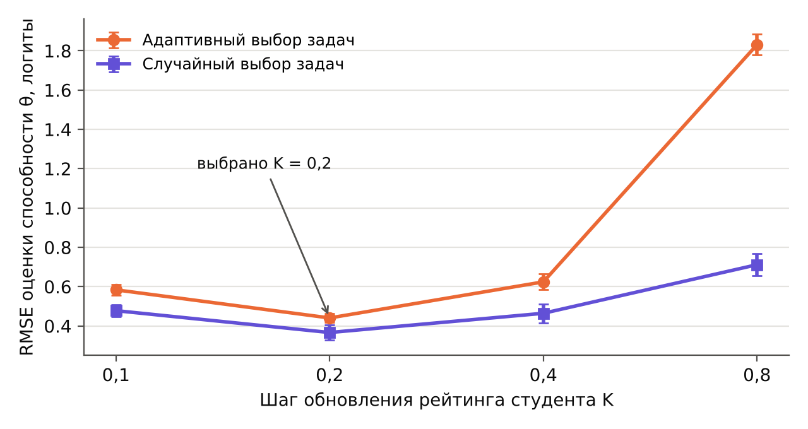

Дисциплина: CSE7942 Research Project

Магистрант: Захаров Д. В., 2 курс, Satbayev University

Тема диссертации: платформа для обучения программированию с адаптивной геймификацией

Репозиторий: https://github.com/1StPersona/NIRM-gamified-learning

# Задание 1. Анализ предварительных результатов

## Какие данные есть

Эксперимент со студентами (три условия К / СГ / АГ, лекция 7) ещё не проведён. Поэтому предварительные результаты получены на модели и на прототипе сервиса. Это три набора данных, все лежат в `bench/results/` репозитория:

| Набор | Как получен | Объём | Что проверяет |
| --- | --- | --- | --- |
| `policies.csv`, `policies_students.csv` | новая симуляция этой работы (`simulation/policies.py`): три политики выбора задач на одних и тех же синтетических студентах | 3 политики × 5 повторов × 300 студентов × 60 попыток = 270 000 попыток | механизм основной гипотезы: держит ли адаптивный выбор задачи в зоне посильной сложности |
| `simulation.csv` | калибровка шага Эло (лекция 8) | 8 конфигураций × 5 повторов | точность оценки способностей и прогноза успеха (RQ3) |
| `load.csv` | нагрузочный тест сервиса (лекция 8) | 8 конфигураций × 3 повтора × 10 с | время обратной связи как контрольная переменная |

**Модель студента.** Истинная способность θ ~ N(0, 1), 50 задач с истинной сложностью от −2,5 до 2,4 логита. Исход попытки разыгрывается по логистической модели. Система видит только исходы и оценивает θ и сложности правилом Эло с K = 0,2 (задачи 0,1).

**Сравниваемые политики** (аналоги условий эксперимента):

- **линейный порядок (СГ)** — задачи упорядочены по метке сложности преподавателя; после успеха студент переходит к следующей, после неудачи повторяет ту же;
- **адаптивный выбор (АГ)** — задача, у которой прогноз успеха ближе всего к p\* = 0,7 (формула 2.12);
- **АГ + 10 % случайных задач** — вариант, предложенный в лекции 8 для проверки RQ3: каждая десятая задача выдаётся случайно.

**Новая метрика.** Доля попыток, в которых истинная вероятность успеха лежит в диапазоне 0,5–0,85 («зона посильной сложности»). Задача вне этой зоны либо слишком лёгкая, либо почти нерешаемая. Метрика вычисляется только в симуляции, где истинная θ известна.

## Этапы анализа

1. **Очистка.** Пропусков и ошибок в данных нет: симуляция детерминирована при `--seed 42`, в нагрузочном тесте 0 ошибочных запросов. Выбросов не удаляли.
2. **Описательная статистика.** Для каждой метрики: среднее по 5 независимым повторам и 95 % доверительный интервал по t-распределению (4 степени свободы). Для метрик по студентам — по 1 500 студентам (300 × 5 повторов).
3. **Статистические выводы.** Сравнение политик — t-тест Уэлча и критерий Краскела–Уоллиса, размер эффекта d Коэна. Сравнение значений K — однофакторный дисперсионный анализ и парный t-тест (повторы с одинаковым seed образуют пары). Сравнение AUC двух моделей прогноза — парный t-тест по повторам.
4. **Визуализация.** Два рисунка и две таблицы ниже.
5. **Интерпретация** — задание 4.

Весь анализ воспроизводится командами `make policies` и `make analyze` (скрипт `analysis/preliminary.py`, итоговые числа сохраняются в `bench/results/preliminary_stats.json`).

**Важная оговорка.** В симуляции p-значения почти всегда очень малы, потому что число наблюдений задаёт сам исследователь. Поэтому выводы ниже опираются на размер эффекта и доверительные интервалы, а p-значения приведены для полноты.

# Задание 2. Иллюстрации

**Таблица 1 — Сравнение политик выбора задач (среднее по 5 повторам, в скобках 95 % ДИ)**

| Метрика | Линейный порядок (СГ) | Адаптивный выбор (АГ) | АГ + 10 % случайных |
| --- | --- | --- | --- |
| Доля попыток в зоне 0,5–0,85 | 0,40 \[0,40; 0,41\] | **0,79** \[0,77; 0,81\] | 0,77 \[0,76; 0,78\] |
| Доля успешных попыток | 0,58 \[0,57; 0,58\] | 0,71 \[0,71; 0,72\] | 0,69 \[0,69; 0,69\] |
| Среднее отклонение P(успех) от p\* = 0,7 | 0,22 | **0,11** | 0,12 |
| Доля успехов, слабые студенты (нижняя треть θ) | 0,45 | 0,64 | 0,61 |
| Доля успехов, сильные студенты (верхняя треть θ) | 0,70 | 0,78 | 0,77 |
| AUC прогноза Эло на случайно выданных задачах | — | — | 0,807 \[0,796; 0,817\] |
| AUC статических меток на тех же задачах | — | — | 0,781 \[0,778; 0,784\] |

**Таблица 2 — Калибровка шага K при адаптивном выборе задач (5 повторов, 300 студентов × 60 попыток)**

| K | RMSE оценки θ \[95 % ДИ\] | Корреляция с истинной θ | Доля успехов во 2-й половине | log-loss |
| --- | --- | --- | --- | --- |
| 0,1 | 0,58 \[0,56; 0,61\] | 0,93 | 0,704 | 0,568 |
| **0,2** | **0,44** \[0,42; 0,46\] | 0,92 | 0,691 | 0,593 |
| 0,4 | 0,62 \[0,58; 0,66\] | 0,91 | 0,691 | 0,606 |
| 0,8 | 1,83 \[1,78; 1,88\] | 0,91 | 0,694 | 0,613 |

Рисунки построены по рекомендациям лекции: подписаны оси и единицы, показаны интервалы, а не только средние, цвета различимы при нарушениях цветовосприятия, лишних элементов (рамок, заливки фона) нет. Одинаковые сущности на обоих рисунках имеют одинаковый цвет (адаптивный выбор — оранжевый).

# Задание 3. Черновик раздела «Результаты»

## 4. Предварительные результаты

### 4.1. Политика выбора задач

Адаптивный выбор удерживал задачи в зоне посильной сложности почти вдвое чаще линейного порядка: 0,79 (95 % ДИ 0,77–0,81) против 0,40 (0,40–0,41) попыток, разность 0,39, d Коэна = 2,8 (t Уэлча = 77,3, p < 0,001; таблица 1). Различие между тремя политиками подтверждает критерий Краскела–Уоллиса (H = 2 563, p < 0,001). Доля успешных попыток при адаптивном выборе составила 0,71, при линейном порядке 0,58.

Выигрыш неодинаков для студентов разной подготовки (рисунок 1). Для слабой и средней трети студентов доля попыток в зоне составила 0,88 и 0,85, для сильной трети только 0,64. При линейном порядке все три группы находились в зоне реже половины попыток (0,36–0,43). Доля успехов у слабой трети выросла с 0,45 при линейном порядке до 0,64 при адаптивном выборе.

Разбивка по четвертям попыток (по 15 попыток) показывает, откуда берётся отставание сильной трети. В первых 15 попытках адаптивный выбор давал им слишком лёгкие задачи (P(успех) > 0,85) в 0,76 попыток, и в зону попадали только 0,23. К последней четверти доля в зоне выросла до 0,85, а доля слишком лёгких задач упала до 0,10. При линейном порядке картина обратная: слабая треть в первой четверти была в зоне в 0,88 попыток, но к третьей и четвёртой четверти доля упала до 0,02 и 0,00, то есть студенты застревали на непосильной задаче.

Выдача 10 % задач случайно снизила долю попыток в зоне с 0,79 до 0,77 и долю успехов с 0,71 до 0,69. Для сильной трети студентов доля в зоне, наоборот, немного выросла (0,64 → 0,67).

### 4.2. Точность оценки способностей и прогноза успеха

Шаг K существенно влиял на ошибку оценки способности (дисперсионный анализ: F(3, 16) = 2 287, p < 0,001, η² = 0,998). Наименьшая ошибка получена при K = 0,2: RMSE = 0,44 (0,42–0,46) логита против 0,58 при K = 0,1 (парная разность 0,14, 95 % ДИ 0,12–0,16) и 1,83 при K = 0,8 (рисунок 2, таблица 2). Корреляция оценки с истинной способностью при всех K составила 0,91–0,93. При адаптивном выборе доля успехов во второй половине попыток составила 0,695 (0,692–0,698).

При случайной выдаче задач AUC прогноза успеха по рейтингу Эло составила 0,821, по статическим меткам сложности 0,780 (разность 0,041, 95 % ДИ 0,035–0,046). В варианте с 10 % случайных задач AUC, посчитанная только на этих задачах (в среднем 1 813 попыток на повтор), составила 0,807 против 0,781 (разность 0,026, 95 % ДИ 0,014–0,038, p = 0,004). При чисто адаптивном выборе AUC обеих моделей была 0,54–0,57.

### 4.3. Время обратной связи

При 64 одновременных клиентах 95-й перцентиль задержки сервиса с Redis составил 53 мс (95 % ДИ 45–62), с хранилищем в памяти 17 мс (15–18).

# Задание 4. Интерпретация относительно гипотез

| Гипотеза | Что показали предварительные данные | Вывод |
| --- | --- | --- |
| Основная гипотеза: подбор задач под p\* ≈ 0,7 повысит вовлечённость сильнее, чем фиксированный порядок | Необходимое условие выполняется: адаптивный выбор держит задачи в зоне посильной сложности в 0,79 попыток против 0,40 и удерживает долю успехов у 0,70 | механизм работает в модели; сама вовлечённость на модели не проверяется |
| RQ1 (EI в АГ выше, чем в СГ и К) | данных нет: вовлечённость — поведение людей, симуляция её не моделирует | не проверена, нужен эксперимент |
| RQ2 (доля решённых задач и прирост знаний в АГ выше) | доля успешных попыток в АГ выше (0,71 против 0,58), особенно у слабых студентов | частичная предварительная поддержка первой части; прирост знаний не моделировался |
| RQ3 (Эло прогнозирует успех точнее статических меток) | на случайно выданных задачах AUC Эло выше на 0,03–0,04 | предварительно поддержана; эффект небольшой |

**Что это значит.**

1. **Ожидаемый эффект СГ против АГ определяется в первую очередь слабыми студентами.** Именно у них линейный порядок чаще всего выдаёт непосильные задачи (доля успехов 0,45), а адаптивный выбор поднимает её до 0,64. Если гипотеза верна, в эксперименте разница EI между АГ и СГ должна быть больше в нижней трети по пре-тесту. Это стоит заранее зарегистрировать как запланированный анализ взаимодействия «условие × терциль пре-теста» (в плане лекции 7 стратификация по терцилям уже есть).
2. **Отрицательный результат: «холодный старт» у сильных студентов.** Для верхней трети доля попыток в зоне только 0,64. Причина не в каталоге задач, а в начальной оценке: система начинает всех с θ = 0 и при K = 0,2 поднимает оценку сильного студента до его уровня примерно за 15–30 попыток. Всё это время он получает слишком лёгкие задачи (в первой четверти 0,76 попыток). В реальном курсе это проявится как скука в первую неделю, именно тогда, когда вовлечённость формируется. Меры: начинать с θ, рассчитанной по пре-тесту (пре-тест в плане уже есть), и/или использовать убывающий шаг K, большой на первых попытках, как предлагает Пеланек \[11\]. Обе меры нужно проверить той же симуляцией до эксперимента.
3. **Линейный порядок тоже проваливается, но иначе.** Сильные студенты в начале решают слишком лёгкие задачи (0,99 попыток в первой четверти), а слабые к концу упираются в непосильную задачу и перестают продвигаться (доля в зоне 0,00 в последней четверти). Это прямой механизм потери мотивации, о котором говорится в постановке проблемы (лекция 3).
4. **Цена проверки RQ3 невелика.** 10 % случайных задач снижают долю успехов на 2 п. п. и дают корректную оценку AUC. Это подтверждает изменение плана, предложенное в лекции 8. Выигрыш Эло (0,026 по AUC) мал, поэтому в статье RQ3 следует подавать как проверку качества модели, а не как основной результат.
5. **Статистическая и практическая значимость.** Доля успехов при адаптивном выборе (0,695) статистически отличается от целевой 0,7 (p = 0,001), но отличие 0,5 п. п. практического значения не имеет. Это пример того, почему в главе 3 нужно приводить размер эффекта и интервалы, а не только p.
6. **Время обратной связи не будет смешивающим фактором**: p95 = 53 мс при цели 100 мс одинаково для всех условий.

**Связь с литературой.** Результат 1 согласуется с работами Пеланека \[11\] и Клинкенберга и др. \[12\], где адаптивный подбор по Эло удерживает успешность около заданного уровня. Небольшой и неустойчивый эффект геймификации в мета-анализе \[4\] может объясняться тем, что выигрыш сосредоточен в части студентов, а усреднение по всей группе его размывает; проверка взаимодействия с уровнем подготовки отвечает на это прямо.

**Ограничения.** Данные синтетические, и студенты сгенерированы той же логистической моделью, на которой основан рейтинг Эло. Это благоприятные для Эло условия, поэтому выигрыш по AUC в реальных данных может быть меньше. В модели нет усталости, обучения во время курса, списывания и отказа от занятий. Выводы этой работы касаются только механизма подбора сложности и должны быть проверены в эксперименте.

**Что изменить в плане до предварительной регистрации:** (1) инициализировать θ по пре-тесту или ввести убывающий шаг K; (2) выдавать 10 % задач случайно и считать AUC на них; (3) включить анализ взаимодействия «условие × терциль пре-теста».
