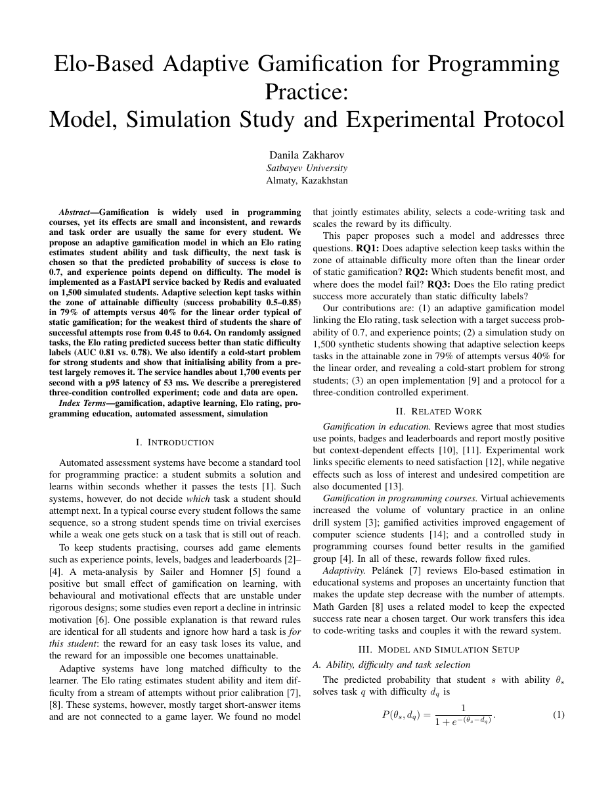
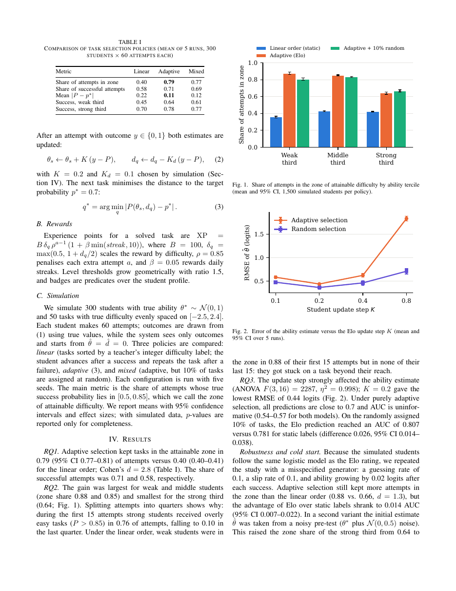

Дисциплина: CSE7942 Research Project

Магистрант: Захаров Д. В., 2 курс, Satbayev University

Тема диссертации: платформа для обучения программированию с адаптивной геймификацией

Репозиторий: https://github.com/1StPersona/NIRM-gamified-learning (папка `paper/`)

# Задание 1. Проект на основе шаблона

**Выбор шаблона: IEEE (IEEEtran, вариант conference).** Причины:

- подходящие площадки для статьи — конференции IEEE по образовательным технологиям (например, ICALT, EDUCON, FIE) и журнал IEEE Transactions on Learning Technologies, где уже публиковались работы из обзора \[9\];
- двухколоночный формат с жёстким лимитом объёма (обычно 4–6 страниц для короткой статьи) дисциплинирует текст;
- шаблон ACM (`acmart`) потребовал бы классификацию CCS; если площадка изменится на ACM (например, SIGCSE, ITiCSE), текст переносится заменой класса документа и стиля библиографии.

Статья пишется на английском языке, так как все перечисленные площадки англоязычные. Русская версия аннотации приведена в работе №11.

**Структура проекта** (папка `paper/` репозитория):

| Файл | Назначение |
| --- | --- |
| `main.tex` | текст статьи, класс `\documentclass[conference]{IEEEtran}` |
| `references.bib` | 14 источников в формате BibTeX |
| `figures/zone_by_tercile.pdf`, `figures/rmse_by_k.pdf` | векторные рисунки |
| `figures.py` | скрипт построения рисунков из `bench/results/preliminary_stats.json` |
| `paper_overleaf.zip` | архив для загрузки в Overleaf |

**Как открыть в Overleaf.** Overleaf → New Project → Upload Project → выбрать `paper_overleaf.zip`. Компилятор pdfLaTeX, основной документ `main.tex`. Второй путь: New Project → Templates → «IEEE Conference Template», затем заменить `conference_101719.tex` на `main.tex` и добавить `references.bib` и папку `figures`. Проект в Overleaf создаётся под собственной учётной записью, поэтому этот шаг выполняется вручную; сборка проверена локально в TeX Live 2023 с тем же классом IEEEtran.

Рукопись лежит в Git (лекция 12: «используйте контроль версий для черновиков»). Overleaf можно связать с репозиторием через Menu → GitHub (в платных тарифах) или синхронизировать вручную.

# Задание 2. Пример страницы

Подготовлена не одна страница, а полный черновик короткой статьи на 4 страницы (после доработки по рецензии в работе №13). Первая страница содержит всё требуемое: заголовок, автора, аннотацию и ключевые слова (Index Terms); на второй странице таблица и два рисунка, на третьей вторая таблица.

**Используемые элементы шаблона:**

- заголовок `\title`, блок автора `\IEEEauthorblockN` / `\IEEEauthorblockA`;
- `abstract` и `IEEEkeywords`;
- нумерованные формулы (`equation`) со ссылками `\ref`;
- таблица `table` с пакетом `booktabs`: без вертикальных линий, подпись над таблицей, как требует IEEE;
- рисунки `figure` на ширину колонки (`\columnwidth`), подпись под рисунком;
- ссылки на источники `\cite{...}`, стиль `IEEEtran.bst`.





**Пример кода таблицы** (по рекомендации лекции: кратко, без вертикальных линий, содержательное название):

```
\begin{table}[t]
\caption{Comparison of task selection policies
         (mean of 5 runs, 300 students $\times$ 60 attempts each)}
\label{tab:policies}
\centering
\begin{tabular}{@{}lccc@{}}
\toprule
Metric & Linear & Adaptive & Mixed \\
\midrule
Share of attempts in zone & 0.40 & \textbf{0.79} & 0.77 \\
...
\bottomrule
\end{tabular}
\end{table}
```

**Рисунки.** Построены заново для статьи: английские подписи, шрифт с засечками в размере 8 пт (как основной текст колонки), сохранены в PDF (вектор), цвета из палитры, проверенной на различимость при нарушениях цветовосприятия. Каждый рисунок упомянут в тексте до своего появления.

# Задание 3. Источники в BibTeX

В `references.bib` 14 записей (требование — не менее пяти): 13 работ из обзора литературы (лекция 2) и репозиторий проекта. Пример записи:

```
@article{pelanek2016,
  author  = {Pel{\'a}nek, Radek},
  title   = {Applications of the {Elo} Rating System
             in Adaptive Educational Systems},
  journal = {Computers \& Education},
  volume  = {98},
  pages   = {169--179},
  year    = {2016},
  doi     = {10.1016/j.compedu.2016.03.017},
  url     = {https://doi.org/10.1016/j.compedu.2016.03.017}
}
```

Приёмы, которые важны для корректного вывода:

- фигурные скобки вокруг имён собственных и аббревиатур в названии (`{Elo}`), иначе стиль IEEE переведёт их в строчные буквы;
- диакритика через команды LaTeX (`Pel{\'a}nek`, `Ib{\'a}{\~n}ez`);
- диапазон страниц через двойной дефис (`169--179`);
- стиль `IEEEtran.bst` не печатает поле `doi`, поэтому DOI продублирован в поле `url` в виде `https://doi.org/...`. Так у каждой статьи в списке литературы виден DOI.

У 12 из 13 статей есть DOI. У Dicheva et al. (2015) DOI нет: журнал Educational Technology & Society в тот год DOI не присваивал. DOI двух записей (Marín et al., 2019; Toda et al., 2018) сверены по открытым каталогам; остальные взяты из обзора литературы и перед подачей должны быть проверены по doi.org.

# Задание 4. Экспорт PDF и проверка оформления

PDF собран командой `pdflatex main && bibtex main && pdflatex main && pdflatex main` (в Overleaf — кнопка Recompile, затем Download PDF). Файл `paper/main.pdf`, 4 страницы.

| Требование шаблона IEEE | Как проверено | Результат |
| --- | --- | --- |
| Двухколоночный формат, класс IEEEtran без изменений полей и шрифтов | в преамбуле нет `geometry`, `\setlength` для полей и смены шрифта | выполнено |
| Размер бумаги | `pdfinfo`: 612 × 792 pt (US Letter) | выполнено; для площадки с A4 добавить опцию `a4paper` |
| Все шрифты встроены (требование IEEE PDF eXpress) | `pdffonts main.pdf`: у всех 21 шрифта `emb = yes` | выполнено |
| Объём | 4 страницы при типичном лимите 4–6 | выполнено |
| Аннотация без ссылок и формул, ключевые слова | проверено вручную | выполнено |
| Таблицы: подпись над таблицей, без вертикальных линий | `booktabs`, `\caption` перед `tabular` | выполнено |
| Рисунки: подпись под рисунком, ссылка в тексте, читаемость | шрифт 8 пт, вектор, ссылка «Fig. 1» до рисунка | выполнено |
| Формулы пронумерованы, переменные определены | 3 формулы, все величины названы в тексте | выполнено |
| Ссылки в стиле IEEE: нумерация по порядку упоминания | `IEEEtran.bst`, `cite` | выполнено |
| Нет неразрешённых ссылок и переполнений строк | в журнале сборки нет `undefined references` и `Overfull \hbox` | выполнено |
| Сведения об авторе | имя и университет есть | **нужно добавить** e-mail университета и ORCID |
| Слепое рецензирование | для площадки с double-blind нужно убрать имя и ссылку на репозиторий (заменить на «anonymized») | сделать при подаче, если требуется |

**Типичные ошибки из лекции, которых удалось избежать:** несогласованные шрифты (в рисунках тот же шрифт с засечками, что в тексте), рисунки без подписей, смешение стилей цитирования (единый `.bib` и стиль).
