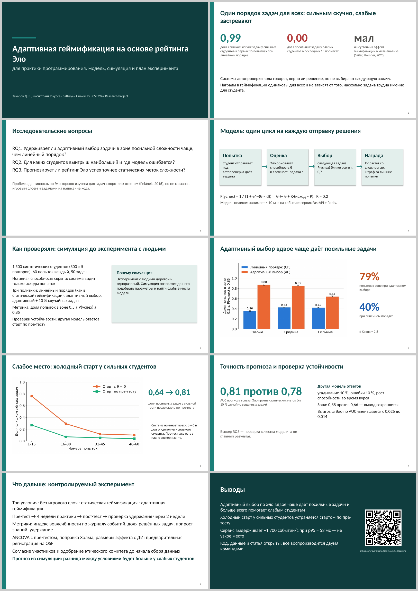
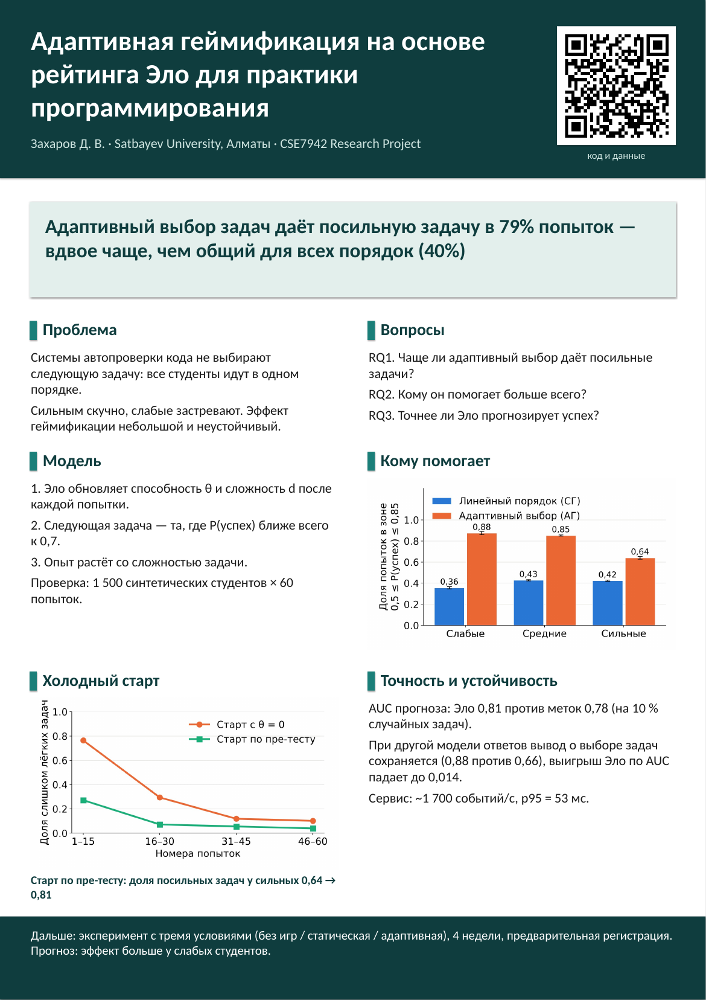

Дисциплина: CSE7942 Research Project

Магистрант: Захаров Д. В., 2 курс, Satbayev University

Тема диссертации: платформа для обучения программированию с адаптивной геймификацией

Файлы: `presentation/doklad.pptx` (доклад, с заметками докладчика), `presentation/poster_A1.pptx` и `poster_A1.pdf` (постер). Оба файла собираются скриптом `python -m presentation.build`, все числа берутся из результатов симуляции, поэтому при пересчёте слайды обновятся сами.

# Задание 1. Презентация на 7–10 минут

**Ключевая мысль доклада** (её слушатель должен унести): адаптивный выбор задач по рейтингу Эло вдвое чаще даёт студенту посильную задачу и больше всего помогает слабым студентам. Она звучит на слайдах 6 и 10 и в заголовке постера.

**Структура и хронометраж** (всего около 8 мин 45 с, запас до 10 минут на паузы):

| № | Слайд | Время | Приём из лекции |
| --- | --- | --- | --- |
| 1 | Титул | 0:00–0:30 | начало с мотивации: «как сделать задачи посильными для каждого» |
| 2 | Проблема: один порядок задач для всех | 0:30–1:30 | три крупных числа вместо абзаца; история «сильным скучно, слабые застревают» |
| 3 | Исследовательские вопросы | 1:30–2:15 | одна идея на слайд |
| 4 | Модель: цикл из четырёх шагов | 2:15–3:15 | схема вместо формул; формулы одной строкой внизу |
| 5 | Как проверяли: симуляция | 3:15–4:00 | объяснение, почему симуляция, а не сразу эксперимент |
| 6 | Результат: 79 % против 40 % | 4:00–5:00 | график с подписанными значениями и вынесенный главный результат |
| 7 | Слабое место: холодный старт | 5:00–6:00 | честный отрицательный результат и его исправление |
| 8 | Точность прогноза и устойчивость | 6:00–7:00 | осторожная формулировка: RQ3 — проверка качества, не главный вывод |
| 9 | План эксперимента | 7:00–8:00 | прогноз, который проверит эксперимент |
| 10 | Выводы и QR-код на репозиторий | 8:00–8:45 | вклад повторяется третий раз |

**Оформление.** Единая палитра (тёмно-бирюзовый для заголовков, оранжевый — всегда адаптивный выбор, синий — всегда линейный порядок), шрифт Calibri, размер текста не меньше 16 пт, заголовки — законченные утверждения, а не темы («Адаптивный выбор вдвое чаще даёт посильные задачи» вместо «Результаты»). На каждом слайде одна мысль. Полный текст выступления — в заметках докладчика к каждому слайду, со временем начала и конца.

# Задание 2. Макет постера A1

Постер — один слайд размером 594 × 841 мм (A1, книжная ориентация) в `poster_A1.pptx`, его можно править в PowerPoint и печатать из `poster_A1.pdf`.

| Требование лекции | Как выполнено |
| --- | --- |
| Читается с 1–2 метров | основной текст 32 пт, заголовки разделов 40 пт, главный вывод 48 пт, название 66 пт |
| Содержит введение, методы, результаты, заключение | блоки «Проблема», «Вопросы», «Модель», «Кому помогает», «Холодный старт», «Точность и устойчивость», нижняя полоса «Дальше» |
| Мало текста, много графики | два графика занимают около трети площади; текст — короткие пункты |
| Выделен вклад | главный результат в отдельной плашке сразу под названием |
| QR-код на статью и код | QR-код на репозиторий в правом верхнем углу |

Порядок чтения: слева направо и сверху вниз, два столбца. Человек, который прошёл мимо, за 5 секунд прочитает название и плашку с главным результатом; тот, кто остановился, за 2 минуты прочитает остальное.

# Задание 3. Репетиция с одногруппником

Репетиция проводится с одногруппником на занятии или по видеосвязи. Порядок:

1. Доклад читается целиком с таймером, без остановок. Одногруппник отмечает время по слайдам.
2. Одногруппник заполняет форму ниже и задаёт 2–3 вопроса.
3. По итогам правятся слайды и заметки; второй прогон — только с таймером.

**Форма обратной связи** (заполняет слушатель):

| Вопрос | Ответ |
| --- | --- |
| Сколько длился доклад? На каком слайде было больше всего времени? | |
| Какую одну мысль вы запомнили? | |
| На каком слайде было непонятно? | |
| Был ли слайд, перегруженный текстом? | |
| Темп речи: слишком быстро / нормально / слишком медленно | |
| Читал ли докладчик со слайдов? | |
| Какой вопрос вы бы задали? | |

**Самопроверка до репетиции.** Текст заметок докладчика содержит около 700 слов; при обычном темпе 110–130 слов в минуту это 5,5–6,5 минуты речи, с паузами и указанием на графики — 7,5–8,5 минуты, то есть в пределах 7–10 минут. Если на репетиции доклад выйдет длиннее 10 минут, первым сокращается слайд 5 (его содержание можно сказать одной фразой на слайде 6).

После репетиции в эту работу нужно внести: фактическое время, замечания одногруппника и что изменено.

# Задание 4. Ответы на вероятные вопросы

**1. «Результаты получены на симуляции. Почему вы уверены, что на настоящих студентах будет так же?»**

Я не уверен, и в докладе этого не утверждаю. Симуляция проверяет механизм: что алгоритм действительно подбирает посильные задачи. Влияние на вовлечённость можно измерить только на людях, поэтому следующий шаг — эксперимент с тремя группами. Чтобы симуляция не была подогнана под модель, я проверил вариант, где студенты угадывают, ошибаются по невнимательности и учатся во время курса. Главный вывод сохранился: 0,88 против 0,66.

**2. «Почему целевая вероятность успеха именно 0,7?»**

Это компромисс между мотивацией и обучением: при слишком высокой вероятности задачи скучные, при низкой студент чаще ошибается и бросает. Значения около 0,7–0,75 используются в адаптивных системах с рейтингом Эло, например в Math Garden. Параметр p\* задаётся в конфигурации, и в будущем его можно будет подобрать по данным эксперимента; в этом исследовании он фиксируется до начала сбора данных.

**3. «Не начнут ли студенты специально проваливать задачи, чтобы получать лёгкие?»**

Хороший вопрос, такой риск есть. Провал снижает оценку способности, и система даёт более лёгкие задачи, но за лёгкую задачу начисляется меньше опыта, потому что опыт растёт со сложностью. Поэтому стратегия «проваливать» невыгодна по очкам. В эксперименте я буду отслеживать подозрительные серии быстрых неудачных попыток; если такое поведение заметно, это будет отдельный результат.

**4. «Чем ваш подход отличается от обычных адаптивных систем?»**

Адаптивные системы с Эло подбирают сложность, но обычно для задач с коротким ответом и без игрового слоя. Здесь подбор сложности и награды связаны: одна и та же оценка сложности определяет и следующую задачу, и количество опыта. И задачи — на написание кода с автопроверкой.

**5. «Хватит ли 90 студентов, чтобы что-то обнаружить?»**

Для попарного сравнения 30 студентов на группу хватает, чтобы надёжно обнаружить эффект от d ≈ 0,75; средний эффект d = 0,5 потребовал бы около 64 на группу. Поэтому в анализе есть пре-тест как ковариата, который повышает мощность, и я заранее решил: если студентов меньше 90, лучше оставить две группы (статическая и адаптивная), чем три маленькие.

**6. «Почему AUC почти не отличается при адаптивном выборе?»**

Потому что при адаптивном выборе все задачи подбираются так, что прогноз около 0,7, и прогнозам нечего различать. Это свойство метрики, а не модели. Поэтому 10 % задач выдаются случайно, и AUC считается на них.

**Если вопрос, на который нет ответа:** «Хороший вопрос, я этого не проверял. Я бы проверил это так: … Спасибо, запишу в ограничения». Признать, что не знаешь, лучше, чем импровизировать с числами.
