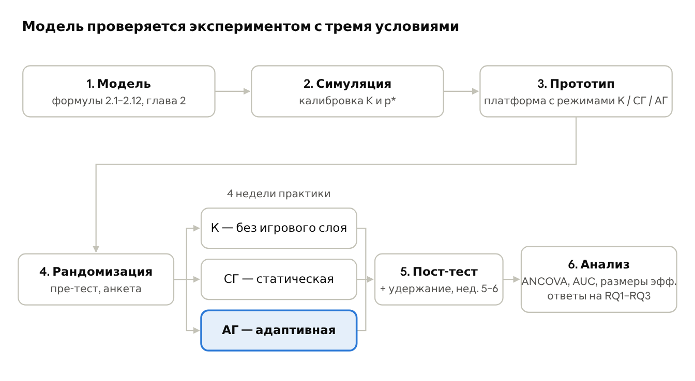

## Лекция 5. Методы исследования

### 5.1. Тип метода

Исследование смешанное: аналитический метод даёт модель, прототипный показывает её реализуемость, экспериментальный отвечает на RQ. Ведущий метод — **экспериментальный**, потому что RQ1 и RQ2 сравнительные и требуют причинного вывода.

| Этап | Тип метода | Что делается | Результат | RQ |
| --- | --- | --- | --- | --- |
| 1. Модель | аналитический | формализация метрик, начисления XP, рейтинга Эло и правила выбора задачи (формулы 2.1–2.12) | формальная модель, глава 2 | все |
| 2. Симуляция | аналитический | прогон модели на синтетических студентах для подбора K и проверки сходимости рейтинга | обоснованные параметры | RQ3 |
| 3. Прототип | прототипный | микросервисная платформа с песочницей и тремя режимами (К / СГ / АГ) через флаг конфигурации; нагрузочное тестирование | рабочая система и журнал событий | все |
| 4. Эксперимент | экспериментальный | студенты случайно распределяются по трём условиям, пре-тест → 4 недели практики → пост-тест и анкета | данные для H1–H3 | RQ1–RQ3 |

### 5.2. Черновик раздела «Методология»

**Модель.** Система описывается моделью из главы 2. Активность студента фиксируется как поток событий (вход, открытие квеста, отправка решения, вердикт, награда). Из него вычисляются показатель активности, коэффициент завершения и устойчивость занятий, которые после нормализации сводятся в индекс вовлечённости:

```latex
EI(u) = \sum_{k=1}^{m} w_k \, \tilde{x}_k(u), \qquad \sum_{k=1}^{m} w_k = 1
```

Рейтинг студента θ и сложность задачи d обновляются после каждой попытки по правилу Эло; следующая задача выбирается так, чтобы ожидаемая вероятность успеха была ближе всего к p\*:

```latex
P(\text{успех}) = \frac{1}{1 + e^{-(\theta_u - d_q)}}, \qquad \theta_u \leftarrow \theta_u + K\,(s - P), \qquad q^{*} = \arg\min_{q} \left| P_{u,q} - p^{*} \right|
```

**Прототип.** Модель реализована в микросервисной платформе: Python/FastAPI, React, Traefik, Keycloak, PostgreSQL (схема на сервис), RabbitMQ, Redis, Docker Compose. Решения запускаются в изолированной песочнице. Сервис геймификации и сервис аналитики получают одни и те же события из очереди, поэтому метрики собираются независимо от игровой логики. Условие эксперимента задаётся для каждого студента флагом конфигурации: в условии К игровой интерфейс скрыт, в СГ порядок задач линейный и XP фиксирован, в АГ работает полная модель. Набор задач и тест-кейсов во всех условиях одинаков.

**Участники и процедура.** Студенты IT-направлений Satbayev University, изучающие вводный курс программирования, участвуют добровольно после информированного согласия. Студенты распределяются по условиям случайно, со стратификацией по баллу пре-теста. Процедура: пре-тест и анкета мотивации → 4 недели работы на платформе → пост-тест и повторная анкета → проверка удержания через 2 недели после окончания. Подробный план, переменные и статистика — в разделе лекции 7.

**Инструменты измерения.** Объективные данные — журнал событий сервиса аналитики. Субъективные — анкета внутренней мотивации (адаптированная версия Intrinsic Motivation Inventory). Учебный результат — пре- и пост-тест из задач одинаковой сложности, не входящих в набор квестов.

### 5.3. Обоснование соответствия метода RQ

- **RQ1 и RQ2 сравнительные.** Ответить на них можно только сравнением групп при равных условиях. Случайное распределение снимает главную слабость работ \[2, 3, 9\] — отсутствие контроля.
- **Два базовых условия нужны для разделения эффектов.** Сравнение СГ с К показывает эффект игрового слоя, сравнение АГ со СГ — вклад именно адаптации. Это аналог абляционного исследования.
- **RQ3 проверяется на журнале попыток** аналитически: качество прогноза успеха (AUC, log-loss) сравнивается с базовой моделью статических меток, как в \[11\].
- **Прототип необходим, а не самоцель.** Без рабочей платформы нет журнала событий, а без журнала нельзя измерить EI объективно.
- **Ограничения ресурсов учтены.** Один университет и один семестр ограничивают внешнюю валидность; это честно указывается в обсуждении.

### 5.4. Схема планируемого исследования



```
1. Модель (формулы 2.1–2.12) → 2. Симуляция (калибровка K и p*) → 3. Прототип (режимы К / СГ / АГ)
   → 4. Рандомизация (пре-тест, анкета)
        → К — без игрового слоя  ┐
        → СГ — статическая       ├─ 4 недели практики → 5. Пост-тест + удержание (нед. 5–6) → 6. Анализ (ANCOVA, AUC, размеры эффекта) → ответы на RQ1–RQ3
        → АГ — адаптивная        ┘
```

Этапы 1–3 создают и калибруют модель, этапы 4–6 проверяют её: студенты случайно попадают в одно из трёх условий, а главное сравнение — АГ против СГ.
