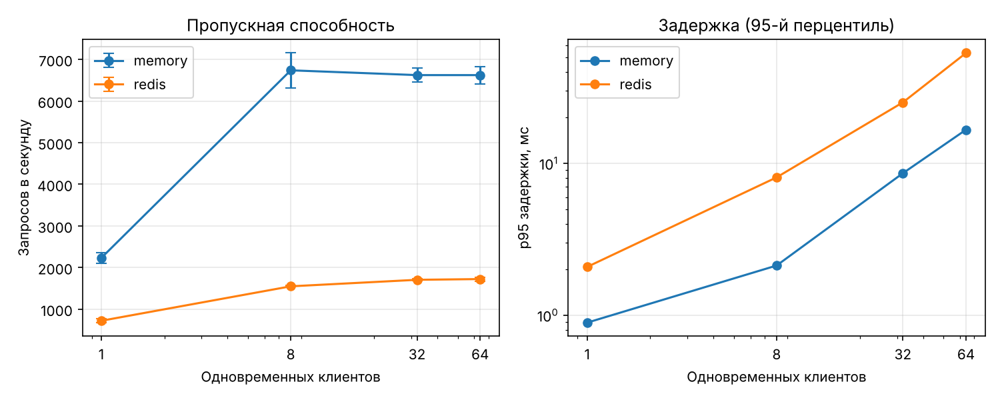

## Лекция 8. Эксперименты в системных и серверных исследованиях

### 8.1. Выбранная система

Для эксперимента выбран **сервис геймификации** платформы. Он обрабатывает событие «решение проверено»: обновляет рейтинги Эло студента и задачи, начисляет опыт, обновляет лидерборд в Redis и выбирает следующий квест. Сервис стоит на критическом пути обратной связи: студент видит награду только после его ответа.

Выбор обоснован тремя причинами. Во-первых, план эксперимента (лекция 7) требует, чтобы время обратной связи было одинаковым во всех условиях, иначе задержка станет смешивающим фактором. Во-вторых, в дедлайны поток отправок резко растёт. В-третьих, это первый сервис, где реализована модель главы 2, и на нём можно проверить, что адаптивная логика не создаёт заметных накладных расходов.

Код сервиса, тесты и скрипты бенчмарка лежат в репозитории `1StPersona/NIRM-gamified-learning` (каталоги `gamification/`, `services/`, `bench/`, `simulation/`).

### 8.2. План бенчмаркинга

| Уровень | Что проверяется | Нагрузка | Метрики | Инструменты |
| --- | --- | --- | --- | --- |
| Микробенчмарк | функции модели: P(успех), обновление Эло, выбор задачи из 50, XP, уровень, индекс EI | 2 000–20 000 вызовов × 7 повторов | медиана времени вызова, мкс | `timeit` (`bench/micro.py`) |
| Макробенчмарк | сервис целиком: HTTP → модель → хранилище | замкнутая модель: 1, 8, 32, 64 одновременных клиента, без пауз; 1 000 пользователей, 50 задач, 70 % успешных решений | пропускная способность (запр/с), задержка p50/p95/p99, доля ошибок | uvicorn, aiohttp-генератор (`bench/load.py`) |
| Сравнение хранилищ | цена сетевого хранилища | те же уровни нагрузки | то же | хранилище в памяти против Redis 7.0 |
| Модельный эксперимент | калибровка шага K рейтинга Эло | 300 синтетических студентов × 60 попыток, 5 повторов на значение K | RMSE и корреляция оценки θ с истинной, доля успехов, AUC, log-loss | NumPy (`simulation/simulate.py`) |

**Рабочая цель (SLO), которую нужно согласовать:** p95 задержки сервиса не более 100 мс при 64 одновременных клиентах. Это на порядок меньше, чем время проверки кода в песочнице, поэтому геймификация не будет заметна на фоне проверки.

**Процедура.** Каждый прогон: 2 с прогрева (не учитывается) и 10 с замера. Для каждой комбинации «хранилище × число клиентов» сделано 3 повтора, в таблицах приведены среднее и стандартное отклонение. Перед прогоном Redis очищается. Генератор нагрузки работает в 2 процессах, чтобы он сам не стал узким местом (см. 8.5).

### 8.3. Экспериментальная установка

| Параметр | Значение |
| --- | --- |
| Процессор | Intel Xeon @ 2,10 ГГц, 4 ядра (виртуальная машина) |
| Память | 15 ГБ |
| ОС | Linux, ядро 6.18 |
| Python | 3.13.16 |
| Сервис | FastAPI 0.162.2, uvicorn 0.54.0, 1 рабочий процесс |
| Хранилище | Redis 7.0.15 на localhost, без сохранения на диск; либо словарь в памяти процесса |
| Генератор нагрузки | aiohttp 3.14.5, 2 процесса, на той же машине |
| Конфигурация | `requirements.txt` с точными версиями, `bench/results/environment.txt` |

Генератор и сервис работают на одной машине через localhost, поэтому сетевая задержка между узлами в результатах не учтена.

### 8.4. Предварительные результаты

**Микробенчмарки** (медиана одного вызова):

| Функция | Время, мкс |
| --- | --- |
| P(успех) по формуле Эло | 0,09 |
| Обновление рейтингов Эло | 0,17 |
| Расчёт XP за решение | 0,24 |
| Уровень по сумме опыта | 0,58 |
| Индекс вовлечённости EI | 1,16 |
| Выбор следующей задачи из 50 | 7,37 |

Вся модель занимает меньше 10 мкс на событие. Самая дорогая операция — перебор задач при выборе следующей. При каталоге в тысячи задач её стоит заменить бинарным поиском по отсортированным сложностям.

**Макробенчмарк** (3 повтора × 10 с, среднее ± стандартное отклонение):

| Хранилище | Клиентов | Запр/с | p50, мс | p95, мс | p99, мс | Ошибки |
| --- | --- | --- | --- | --- | --- | --- |
| память | 1 | 2 231 ± 130 | 0,3 | 0,9 | 1,1 | 0 |
| память | 8 | 6 739 ± 417 | 1,0 | 2,1 | 3,1 | 0 |
| память | 32 | 6 624 ± 168 | 4,3 | 8,6 | 12,0 | 0 |
| память | 64 | 6 624 ± 206 | 8,9 | 16,7 | 20,3 | 0 |
| Redis | 1 | 722 ± 45 | 1,3 | 2,1 | 2,7 | 0 |
| Redis | 8 | 1 550 ± 16 | 4,7 | 8,1 | 10,1 | 0 |
| Redis | 32 | 1 706 ± 23 | 18,1 | 25,2 | 34,4 | 0 |
| Redis | 64 | 1 724 ± 50 | 36,0 | 53,4 | 70,4 | 0 |



**Модельный эксперимент: калибровка K** (300 студентов, 60 попыток, 5 повторов; адаптивный выбор задач по p* = 0,7):

| K | RMSE оценки θ | Корреляция с истинной θ | Доля успехов во 2-й половине | log-loss |
| --- | --- | --- | --- | --- |
| 0,1 | 0,58 | 0,93 | 0,704 | 0,568 |
| **0,2** | **0,44** | 0,92 | 0,691 | 0,593 |
| 0,4 | 0,62 | 0,91 | 0,691 | 0,606 |
| 0,8 | 1,83 | 0,91 | 0,694 | 0,613 |

При случайном выборе задач (контрольный прогон) AUC прогноза Эло составила 0,82 против 0,78 у статических меток сложности. При адаптивном выборе AUC обеих моделей около 0,54–0,57.

### 8.5. Анализ

1. **Запас производительности большой.** Даже с Redis сервис держит около 1 700 запросов в секунду при p95 = 53 мс на 64 клиентах, то есть укладывается в рабочую цель 100 мс. В эксперименте планируется около 90 студентов. Если все они отправят решение в одну и ту же секунду, это меньше 100 запросов, в 17 раз меньше измеренного предела. Геймификация не станет узким местом, и задержка обратной связи не будет различаться между условиями К/СГ/АГ.
2. **Насыщение наступает уже при 8 клиентах.** Дальше пропускная способность не растёт, а задержка растёт пропорционально числу клиентов. Это согласуется с законом Литтла: 64 клиента / 6 624 запр/с ≈ 9,7 мс при измеренной медиане 8,9 мс. Узкое место — единственный процесс uvicorn.
3. **Redis снижает пропускную способность примерно в 4 раза, но сам Redis не узкое место.** По `INFO commandstats` сервер Redis тратит около 10 мкс на запрос. Время уходит на 4 последовательных обращения к Redis из Python на каждое событие. Оптимизации: объединить чтение и запись в один Lua-скрипт (это заодно убирает гонку при одновременных событиях одного студента) и запустить несколько процессов uvicorn.
4. **Методическая находка: генератор нагрузки сам может быть узким местом.** Первый прогон с генератором на httpx в одном процессе показал падение до 350 запр/с при 64 клиентах. Проверка загрузки CPU показала, что генератор занят на 100 %, а сервис только на 11 %. После перехода на aiohttp и 2 процесса пропускная способность выросла примерно в 19 раз. Первые результаты сохранены в `bench/results/load_single_generator.csv` как пример ошибки, описанной в лекции, — нереалистичного бенчмарка.
5. **Калибровка модели.** Выбран шаг K = 0,2 (для задач — 0,1): у него наименьшая ошибка оценки способностей. При K = 0,8 оценки «уплывают» по шкале (RMSE 1,83 при той же корреляции). При всех K доля успехов держится у 0,69–0,70, то есть адаптивный контур удерживает целевую вероятность p* = 0,7.
6. **Следствие для RQ3 (лекция 7).** При адаптивном выборе все прогнозы близки к 0,7, и AUC почти не различает модели. Это свойство метрики, а не модели. Поэтому для RQ3 нужно либо выдавать небольшую долю задач (например, 10 %) случайно и считать AUC на них, либо сравнивать модели по log-loss и калибровке. Это изменение нужно внести в план эксперимента до предварительной регистрации.

### 8.6. Ограничения

- Генератор и сервис на одной 4-ядерной виртуальной машине, обмен через localhost; сетевая задержка между узлами не измерена.
- Нагрузка синтетическая: равномерный выбор пользователей и задач, 70 % успехов. Реальный поток в дедлайн неравномерен.
- Измерен только сервис геймификации. Песочница проверки кода и RabbitMQ ещё не подключены; именно песочница, скорее всего, будет самым медленным звеном.
- Redis без сохранения на диск; при включённом AOF задержки будут выше.
- Одновременные события одного студента обрабатываются как «прочитать — изменить — записать» без блокировки. Для прототипа это допустимо, в рабочей версии нужен Lua-скрипт.

### 8.7. Как воспроизвести

```
pip install -r requirements.txt
make test                         # 34 теста (+1 на Redis при заданном REDIS_URL)
make simulate                     # калибровка K → bench/results/simulation.csv
make micro                        # микробенчмарки → bench/results/micro.json
uvicorn services.gamification_api.app:app --port 8000          # хранилище в памяти
python -m bench.load --label memory --reps 3
REDIS_URL=redis://127.0.0.1:6379/0 uvicorn services.gamification_api.app:app --port 8000
python -m bench.load --label redis --reps 3
make report                       # таблица и график → bench/results, bench/plots
```
